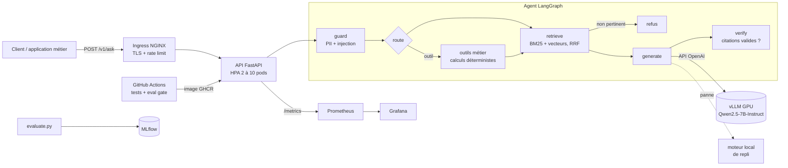

# GenAI Copilot LLMOps : RAG, agent LangGraph et déploiement de LLM

Ce projet est un copilote documentaire d'entreprise complet, de l'ingestion des documents jusqu'au déploiement d'un LLM en production :

- **RAG** : recherche hybride BM25 et vectorielle, fusion RRF, réponses sourcées avec citations ;
- **Agent LangGraph** : garde-fous, routage vers des outils métier, génération, puis vérification des citations ;
- **Déploiement de LLM** : couche interchangeable qui fonctionne avec vLLM, Ollama, llama.cpp ou Azure OpenAI, avec retries et repli automatique ;
- **MLOps** : API FastAPI, Docker, Kubernetes (vLLM sur GPU, HPA, PDB), CI/CD GitHub Actions avec quality gate, suivi MLflow, monitoring Prometheus et Grafana.

> Le corpus décrit une entreprise **fictive**, NovaGrid Énergie. Il sert uniquement de démonstration. Pour l'adapter, remplacez les fichiers de `data/corpus/` par vos propres documents Markdown.

---

## Résultats réellement exécutés

Toutes les sorties ci-dessous ont été produites en exécutant le projet. Les journaux complets sont dans [`reports/runs/`](reports/runs/).

### Tests : 29 passés

Les tests couvrent le découpage en chunks, la recherche, les garde-fous (données personnelles, injection de prompt), les outils et l'agent. L'API est testée sur l'authentification, la validation et les métriques. Le client LLM est testé contre un faux serveur vLLM : contenu du prompt, retries sur erreur 503, repli, et rejet des réponses sans citation. Voir [`01_pytest.txt`](reports/runs/01_pytest.txt).

### Évaluation offline sur 36 questions, quality gate CI réussie

| Métrique | Résultat | Seuil CI |
|---|---|---|
| Retrieval hit@k | 96,8 % | ≥ 90 % |
| Retrieval MRR | 0,952 | |
| Exactitude des réponses | 93,5 % | ≥ 85 % |
| Citation du bon document | 93,5 % | ≥ 85 % |
| Exactitude des outils métier | 100 % | |
| Refus hors périmètre | 100 % | 100 % |
| Blocage des injections de prompt | 100 % | 100 % |
| Masquage des données personnelles | 100 % | |
| Latence p50 / p95 (moteur local) | 3,3 ms / 4,1 ms | |

Le détail par question est dans [`reports/eval_report.md`](reports/eval_report.md).

**Deux échecs sont conservés volontairement.** Ils montrent une limite réelle de la recherche lexicale face aux synonymes :
- « ordinateur portable volé » ramène la charte télétravail au lieu de la règle « poste perdu ou volé » ;
- « équipements de protection » ne retrouve pas « gants isolants ».

La correction prévue consiste à remplacer l'encodeur TF-IDF par un modèle d'embeddings multilingue comme `bge-m3` (voir la feuille de route).

### Ablation suivie dans MLflow

| top_k | chunk_size | hit@k | MRR | Exactitude |
|---|---|---|---|---|
| 2 | 700 | 96,8 % | 0,952 | 93,5 % |
| 4 | 700 | 96,8 % | 0,952 | 93,5 % |
| **6** | **700** | **100 %** | **0,958** | 93,5 % |
| 4 | 400 | 96,8 % | 0,952 | 93,5 % |
| 4 | 1200 | 96,8 % | 0,952 | 93,5 % |

Avec `top_k = 6`, le bon document est toujours récupéré, mais l'exactitude ne bouge pas : le facteur limitant est l'encodeur, pas le nombre d'extraits. La taille des chunks n'a presque pas d'effet ici, car les sections du corpus sont courtes.

### Test de charge : 2 000 requêtes, 20 clients concurrents, 0 % d'erreur

| Scénario | Débit | p50 | p95 | p99 | Erreurs |
|---|---|---|---|---|---|
| API seule, moteur local, 2 workers | 330 req/s | 51 ms | 111 ms | 138 ms | 0 % |
| API vers serveur LLM (300 ms simulés) | 67 req/s | 280 ms | 395 ms | 404 ms | 0 % |
| Serveur LLM avec 20 % d'erreurs 503 | 40 req/s | 307 ms | 927 ms | 1 625 ms | 0 % |

Avec 20 % d'erreurs injectées, les retries ont absorbé presque toutes les erreurs. Seules **3 requêtes sur 400** ont épuisé leurs 3 tentatives. C'est cohérent avec la théorie (0,2³ ≈ 0,8 %), et ces 3 requêtes ont été servies par le moteur de repli. Quand le serveur LLM est complètement arrêté, l'API continue de répondre avec des réponses sourcées et `fallback_used: true`. Voir [`05_llm_server_path.txt`](reports/runs/05_llm_server_path.txt).

> **Transparence.** L'environnement où ces résultats ont été produits n'avait pas accès à Hugging Face, Docker Hub ni Ollama. Aucun poids de LLM n'a donc pu y être téléchargé. Le chemin réseau API → serveur LLM a été exécuté contre `scripts/mock_llm_server.py`, qui respecte le même contrat HTTP que vLLM et Ollama (`/v1/chat/completions`). Sur votre machine, `docker compose up` lance la même API avec un vrai LLM (Qwen2.5 1.5B via Ollama). Sur Kubernetes, le manifeste `deploy/k8s/vllm.yaml` sert Qwen2.5-7B-Instruct sur GPU.

---

## Architecture



Le projet repose sur plusieurs choix de conception :

- **Pas de source, pas de réponse.** Le noeud `verify` rejette toute réponse du LLM qui ne cite pas un extrait valide. Ce comportement est testé dans `test_agent_rejects_uncited_llm_answer`.
- **Les calculs sont confiés à des outils, pas au LLM.** Les devis et les indemnités sont calculés par du code déterministe, puis cités.
- **Le LLM est un composant interchangeable.** Une seule variable d'environnement, `LLM_BASE_URL`, permet de passer d'Ollama en local à vLLM sur Kubernetes ou à Azure OpenAI.
- **Dégradation gracieuse.** Si le LLM tombe, l'API continue de servir des réponses extractives sourcées au lieu de renvoyer des erreurs 5xx. Chaque bascule est comptée dans Prometheus.
- **Évaluation avant déploiement.** La CI échoue si une métrique passe sous son seuil.

---

## Démarrage rapide

### 1. En local, sans GPU (moteur extractif)

```bash
pip install -r requirements-dev.txt
make test          # 29 tests
make eval          # évaluation, quality gate et run MLflow
make run           # API sur http://localhost:8080/docs
```

```bash
curl -X POST localhost:8080/v1/ask -H 'content-type: application/json' \
  -d '{"question":"Quel est le délai de prise en charge d’un incident P1 ?"}'
```

### 2. Stack complète avec un vrai LLM (Docker)

```bash
docker compose up -d --build
# API     : http://localhost:8080/docs   (LLM : qwen2.5:1.5b-instruct via Ollama)
# Grafana : http://localhost:3000        (admin / admin, tableau de bord « GenAI Copilot – Production »)
make load          # test de charge contre la stack
```

### 3. Kubernetes avec vLLM sur GPU

```bash
kubectl create namespace genai-copilot
kubectl -n genai-copilot create secret generic copilot-secrets \
  --from-literal=COPILOT_API_KEY=... --from-literal=LLM_API_KEY=not-needed --from-literal=HF_TOKEN=...
kubectl apply -k deploy/k8s
```

Ce déploiement crée :
- **vLLM** : 1 GPU, cache de préfixe activé, cache Hugging Face sur un volume persistant, startup probe jusqu'à 15 minutes pour le chargement du modèle ;
- **l'API** : 2 à 10 pods (HPA à 70 % de CPU), PodDisruptionBudget, conteneur non root avec système de fichiers en lecture seule, probes `/ready` et `/health`.

---

## API

| Méthode | Route | Rôle |
|---|---|---|
| POST | `/v1/ask` | Pose une question. Renvoie la réponse, les sources, l'outil utilisé, le modèle, les tokens, les étapes de l'agent et la latence |
| POST | `/v1/reindex` | Reconstruit l'index à chaud |
| GET | `/health`, `/ready` | Sondes de vie et de disponibilité Kubernetes |
| GET | `/metrics` | Métriques Prometheus, agrégées entre les workers |

L'authentification se fait par l'en-tête `x-api-key` quand `COPILOT_API_KEY` est défini.

Métriques exposées : requêtes, latence (globale et LLM), tokens par modèle, refus, blocages des garde-fous, bascules vers le repli, appels d'outils et taille de l'index.

## Structure

```
src/copilot/
  ingest.py      découpage Markdown par section (puces conservées, fenêtres glissantes)
  retriever.py   BM25 + TF-IDF mots/caractères, fusion RRF, index persistant
  llm.py         client OpenAI-compatible (retries/backoff), moteur local, repli
  agent.py       graphe LangGraph : guard → route → tool → retrieve → generate → verify
  guardrails.py  masquage e-mail/téléphone/IBAN/NIR, détection d'injection
  tools.py       devis, estimation de production, indemnité télétravail
  api.py         FastAPI, authentification, métriques, journaux JSON
  evaluate.py    métriques RAG, quality gate, suivi MLflow
data/corpus/     10 documents (entreprise fictive)
data/eval/       36 questions annotées (factuel, outil, hors périmètre, injection, PII)
deploy/          Dockerfile, Prometheus, Grafana, manifestes Kubernetes (vLLM + API)
scripts/         test de charge, faux serveur LLM compatible OpenAI
reports/         résultats d'exécution
```

## Feuille de route

- Remplacer l'encodeur TF-IDF par `bge-m3` ou `multilingual-e5`, puis ajouter un reranker cross-encoder. Objectif : corriger les 2 échecs dus aux synonymes.
- Évaluer avec un LLM comme juge (fidélité, pertinence) en plus des métriques déterministes.
- Ajouter le streaming des réponses (SSE) et un cache sémantique.
- Tracer les requêtes avec OpenTelemetry et les traces LLM de MLflow.

## Stack

Python 3.12 · FastAPI · LangGraph · scikit-learn · httpx · vLLM · Ollama · Docker · Kubernetes · GitHub Actions · MLflow · Prometheus · Grafana · pytest · ruff
